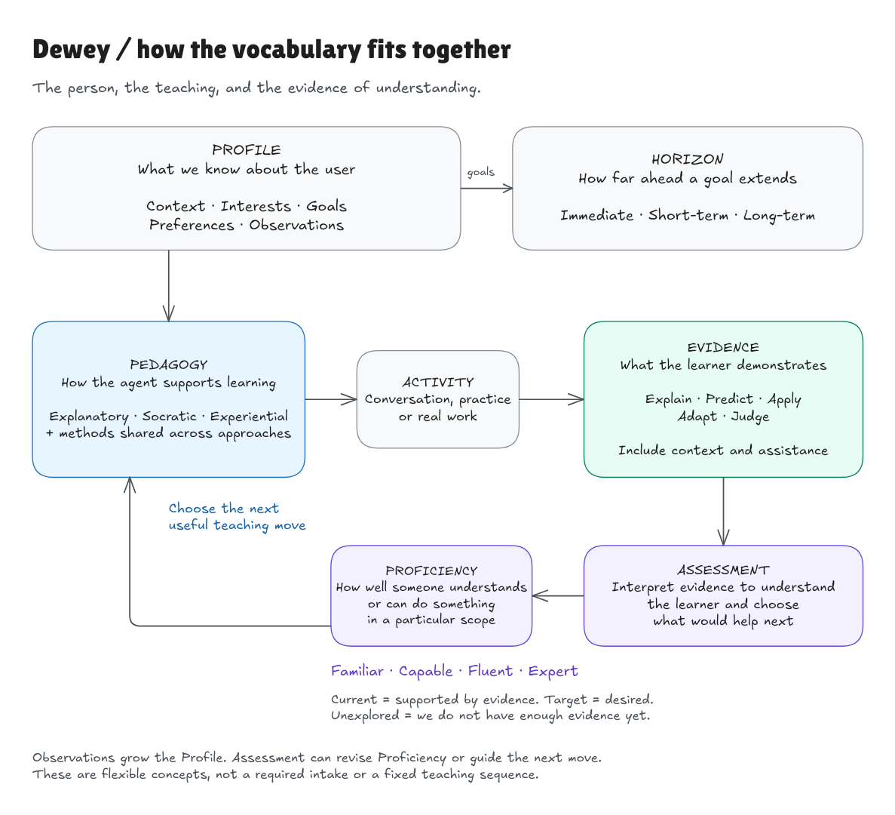
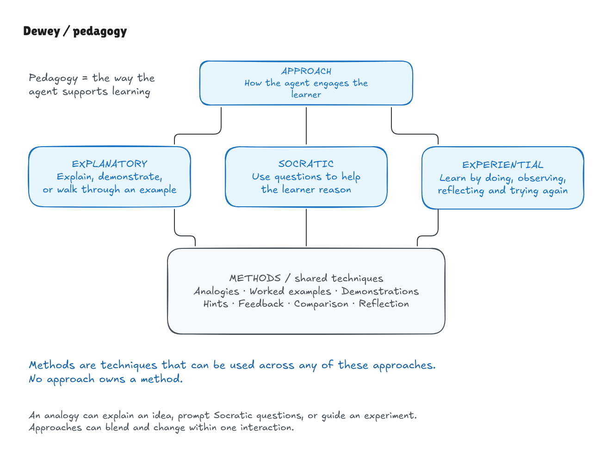

# Dewey vocabulary

Our working vocabulary for how Dewey understands a learner and helps them learn.

## Profile

**What we know about the user.** It can start as a simple list of facts and grow through conversation and observed work.

| Part | What it contains |
| --- | --- |
| **Context** | Their experience, work, available tools, and practical constraints. |
| **Interests** | Topics and activities they care about. |
| **Goals** | What they want to understand or become able to do, and why. |
| **Preferences** | How they would like to interact or receive help. |
| **Observations** | What they have said or done during learning. |

Keep the source and date of relevant facts. Distinguish what the user reports from what they demonstrate. The agent discovers what they know; the user does not need to supply a knowledge inventory.

## Pedagogy

**The way the agent supports learning.** Approaches describe how it engages the learner; methods are the techniques it can use.

### Approach

**How the agent engages the learner.**

| Approach | What it means |
| --- | --- |
| **Explanatory** | Explain, demonstrate, or walk through an example. |
| **Socratic** | Use questions to help the learner examine assumptions, connect ideas, and reason things through. |
| **Experiential** | Help the learner learn by doing, observing results, reflecting, and trying again. |

Approaches can blend and change within one interaction: explain an example, question an assumption, then try it in practice.

### Methods

**Techniques that can be used across any approach.** They form a shared toolbox, not a separate set for each approach.

Examples include analogies, worked examples, demonstrations, hints, feedback, comparison, and reflection. An analogy might explain an idea, become the subject of Socratic questions, or guide a practical experiment.

## Evidence

**What the learner actually demonstrates.** It can come from their explanations, predictions, decisions, actions, or work.

These are our **dimensions of understanding**:

| Dimension | What we look for |
| --- | --- |
| **Explain** | Explain a relationship or give a meaningful reason. |
| **Predict** | Anticipate what will happen and why. |
| **Apply** | Use knowledge or skill to accomplish something. |
| **Adapt** | Change an approach when the situation or evidence changes. |
| **Judge** | Evaluate a result, claim, or tradeoff and recognize its limits. |

Record the situation and assistance, including what AI supplied and what the learner contributed.

**Assessment** means interpreting that evidence to decide what the learner understands and what would help next. Teaching and assessment have different purposes, even when the same interaction does both. A polished AI-generated result alone does not demonstrate the learner's understanding.

## Horizon

**How far ahead the learner’s goal extends.**

| Horizon | What the person needs | What the experience might look like |
| --- | --- | --- |
| **Immediate** | Understand or do something useful now, within this interaction. | Understand a diagram, resolve a question, or try one example. |
| **Short-term** | Work toward a goal over the coming days or weeks. | Prepare for an interview in three weeks or learn to check an AI-assisted workflow this week. |
| **Long-term** | Develop understanding or ability over months or longer. | Understand machine learning deeply or build conversational ability in another language. |

Horizon describes timeframe only. Preserve actual deadlines and available time in the profile; the labels are summaries without rigid cutoffs. Leave the horizon unspecified when the learner has not supplied enough information. An Immediate question can sit within a Long-term goal, and the goal can change. Whether the goal has been met is a practical fact, not another vocabulary category. A Long-term horizon does not imply an Expert target.

## Proficiency

**How well someone understands or can do something within a particular scope.**

| Level                                                                                    | The claim we’re making                                                                        | What AI-era evidence might look like                                                                                                                    |
| ---------------------------------------------------------------------------------------- | --------------------------------------------------------------------------------------------- | ------------------------------------------------------------------------------------------------------------------------------------------------------- |
| **Familiar** | You have a useful initial mental model.                                                       | After an AI explanation, you make a meaningful distinction or predict a simple consequence the explanation didn’t already supply.                       |
| **Capable**   | You can accomplish a bounded purpose and judge the relevant result.                           | AI performs substantial work, while you make consequential choices and check whether the result serves your purpose.                                    |
| **Fluent**     | You can reason and act flexibly across meaningful variations.                                 | When requirements or evidence change, you revise the approach—including accepting or challenging AI for defensible reasons.                             |
| **Expert**     | You show sustained judgment within a domain, including unfamiliar, poorly specified problems. | You decide how to frame the problem, which investigations would be informative, what to delegate, and where the resulting conclusions remain uncertain. |

**Current proficiency** is supported by evidence. **Target proficiency** is what the learner wants to reach. **Unexplored** means we do not have enough evidence yet.

Use a scope such as “Capable at checking a basic classifier evaluation.” AI assistance can be appropriate at every level; what the learner contributes still matters.

## How it fits together

The profile informs how the agent teaches. The learner's contributions provide evidence. Assessment helps update our view of their proficiency and choose what to do next. Their goal and horizon guide the direction and pace.

The vocabulary map connects these five concepts and shows how learning updates what we know about the person.

[Edit the vocabulary map](https://app.excalidraw.com/s/2wiTvWXU7mf/3p81oZitsyu) · [Excalidraw file](vocabulary-map.excalidraw)

The pedagogy diagram shows three approaches using one shared toolbox of methods; methods can support any approach.

[Edit the approaches diagram](https://app.excalidraw.com/s/2wiTvWXU7mf/zFBKZAgvz1) · [Excalidraw file](approaches-and-methods.excalidraw)

## Further reading

These are Dewey's working definitions, not a validated proficiency scale. See the vocabulary research, teaching approaches, and proficiency research for the grounding and fuller distinctions.
